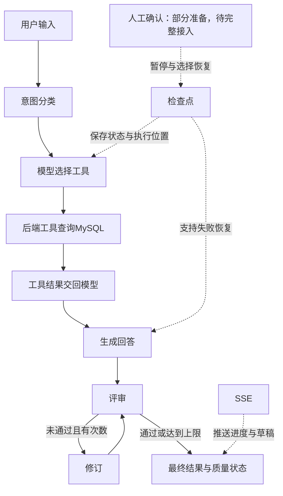

# 2026-11-06 日结：库存Agent、图状态、质量检查与流式反馈

## 位置与证据

- 日历目标D16；实际授课进入D10。D09主线已讲，D09/D10独立综合检查待完成。完整独立验收保持1/32。
- 当前主项目projects/operations-assistant-fresh/backend，端口8020。旧项目保留参考。
- 学生提交过完整库存问答：广州可售28、预留8、在途120；深圳可售6、预留2、在途40；阈值20，深圳差额14，数据来源synthetic_demo。
- 教师质量闭环验证：模拟模型与工具下5项流程、3种HTTP质量状态通过。
- 教师检查点验证：6项通过，包含真实MySQL三表工具、状态跨独立Python进程读取、失败节点恢复、计数保留、完成任务重复恢复、并发锁、HTTP404/422。模型使用模拟响应，真实模型效果独立验收。
- 学生保存人工确认状态和检查点暂停信息读取；实际interrupt节点及确认提交接口待实现。流式入口已有实际请求日志；真实模型在classifier节点返回403，用户确认账号欠费，约定下周恢复联调。

## 今天的业务主线

用户输入→HTTP校验→意图分类→模型产生tool_calls→ToolNode执行库存工具→服务层计算低库存→repository查询商品/店铺/库存三表→ToolMessage回传→模型回答→critic核对事实→必要时refine修订，最多两次→返回最终回答和quality。

检查点沿途保存图状态；SSE将执行进度和后续文字片段发送给前端。人工确认通过interrupt暂停，并通过原thread_id与Command(resume=选择)恢复，当前属于机制讲解及部分读取准备。

## 六项必背答案

1. 模型根据工具名称、说明和参数Schema生成tool_calls；后端执行工具并返回匹配tool_call_id的ToolMessage；模型根据结果作答。
2. State保存共享数据，Node执行一步并返回字段更新，Edge决定下一步。循环需要业务退出条件和硬上限。
3. Critic核对回答与工具事实，Refine按意见修订。达到修订上限仍未通过时，quality标为needs_review，保留真实结果。
4. Checkpointer按thread_id保存图状态和执行进度。新任务传入初始State；恢复失败任务传None并沿用原编号。失败节点可能重新执行，外部写操作需要幂等。
5. interrupt返回待确认内容并暂停；用户选择通过Command(resume=...)传回，相同thread_id定位原任务。恢复时所在节点从头执行，修改操作安排在确认通过之后。
6. SSE持续发送事件。updates用于节点更新，messages用于模型文字；step展示步骤，delta展示草稿，done携带最终结果，error结束失败状态。最终回答以评审完成后的result.answer为准。

## 易混点与排错

- 任务编号task_id与配置字段thread_id在当前功能采用相同值。用户id、会话id及暂停id各有独立用途。
- 当前一问一任务；后续多轮业务会话与任务关联需要单独设计。
- 图流程完成与质量通过分别表达：completed与quality.passed并行判断。
- updates事件发生在节点完成后，提示使用“查询完成”；节点开始提示需要相应开始事件。
- SSE连接返回HTTP200后，后续模型失败仍通过error事件反馈；200仅确认连接建立。
- 本次403发生在classifier模型调用处；最小请求复现AccessDenied.Unpurchased。用户随后确认欠费，停止重复请求，待充值再验。
- 当前项目模型已改为qwen3.8-flash，北京地域接口；密钥继续仅保存在本机忽略文件。示例使用DASHSCOPE_API_KEY，项目实际读取OPENAI_API_KEY，配置须匹配。

## 下周接续与复习

1. 充值后重启8020，做一次最小模型调用，再验证POST /assistant/stream。
2. 观察start→step→delta→done，错误分支观察error；核对最终回答与库存工具事实。
3. 核对文字流增量实际保存情况，再完成前端草稿/最终结果展示。
4. 人工确认节点、批准/拒绝提交及分流仍待实现；子图专项和D09/D10综合独立验收保留。
5. 到课复习按+1/+3/+7/+14自然日处理：11/07、11/09、11/13、11/20；周末节点顺延到下一到课日合并复习。

## 课程导图

## 教学节奏约定

后续先讲当前目标和调用链，指出具体新增位置，再由学生保存一段并观察结果。完整功能使用AI辅助，教师解释关键代码，学生承担修改、核对和排错。容易理解的机制快速串联，实战重复巩固；讲解、运行与独立掌握分别记录。原27课程及两个项目完整范围保留，新扩展技术栈逐项实作，简历只描述实际证据。
