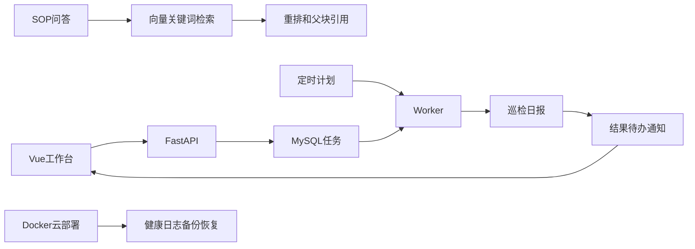

# 2026-11-10 自动任务与私有云交付

只读ps进一步定位：既有trading-research/run_continuous_bounded.py占约1.9GB RSS，本次ES约307MB、API约101MB、MySQL约51MB。多应用共用资源发生竞争；其他项目进程保持原样。

最终状态：功能与备份恢复验证之后，云端可用内存降至64MB、swap满、负载103，SSH与隧道出现超时。当前云端可用性待恢复，停止本次6容器尚未收到成功确认，显式stop被自动审批拦截待用户授权。本机3020页面HTTP200、8020 Worker healthy已复核。提交221dda1保存在本地；push到RosieAlan/agent被自动审批拦截，待用户确认目标远端。部署演练成功证据与当前可用性分别记录。

## 业务串联

Vue工作台发起巡检或日报 → FastAPI校验并保存任务 → Worker领取MySQL任务 → 按演示库存计算 → 同一事务保存结果、待办和站内通知 → 页面轮询展示。

每天09:00巡检、18:00日报采用Asia/Shanghai，下一次执行时间保存UTC。关闭页面后Worker继续处理；重启后恢复过期租约；唯一幂等键避免重复创建任务。通知当前为站内收件箱。

SOP上传 → 父子分块 → Embedding → PG/pgvector → ES同步 → 向量/BM25召回 → RRF → Rerank → 回取父块 → flash按资料回答和引用。

## 运行证据

- 腾讯云operations-production六服务健康，旧应用保留；网关未认证401、认证后ready正常。
- 真实日报3a9a9641-a4b9-4881-abfe-f3caf763cebd completed，attempts=1，2库存/1低库存。
- SOP6块索引同步成功，采购审批真实问答hybrid、空warnings、运营主管答案和摘录准确，context_type=parent。
- 备份20261110T044517Z校验和、临时库恢复通过；MySQL2库存/1任务，PG1文档/6块，临时库清理。
- 4组DB/API检查通过，含幂等冲突、并发领取、租约、重试、失败通知唯一性；另有事务回滚与定时到期检查。
- Python编译/依赖、Vue类型/构建、镜像构建、Compose配置通过。浏览器自动化不可用，实际点击待本人验收。
- 修复MySQL8 RSA认证依赖、Worker健康检查路径、PG恢复后ES索引重建、最终失败通知。

## 文件职责

| 文件 | 职责 |
|---|---|
| backend/operations/api.py | HTTP参数、响应与错误映射 |
| backend/operations/service.py | 巡检、日报规则与计划时间 |
| backend/operations/repository.py | 事务领取、幂等、租约、结果和通知 |
| backend/operations/worker.py | 轮询、执行与心跳 |
| frontend/src/App.vue | 用户工作台 |
| infra/deploy | 镜像、网关、发布、备份恢复 |

## 必背答案

1. 后台任务为什么存数据库？任务状态与结果需要跨重启保留，Worker按状态领取和恢复。
2. 怎样减少重复执行？提交使用唯一幂等键；Worker事务领取并校验租约；结果与通知一起落库。外部写操作还需对应系统的幂等和执行结果查证。
3. 怎样验证备份？核对校验和，恢复到临时数据库，查询关键表与数据，随后清理临时库。
4. 当前交付范围？私有访问云部署、持久任务、工作台、健康检查日志和备份恢复。域名HTTPS、逐用户授权、外部通知、异地备份、报警压测与回滚继续专项验收。

## 进度与复习

11/10，日历D18；用户授权集中交付后进入D17 MCP。独立通过1/32（3.125%），教师代验分开记录。D15/D16完整评测、PDF/OCR、Wiki和权限等原课缺口保持。

复习日期11/11、11/13、11/17、11/24：讲清任务链、故障恢复和备份验证。下节D17原课第十二章12.1–12.2，从现有库存函数接为MCP工具讲起。

