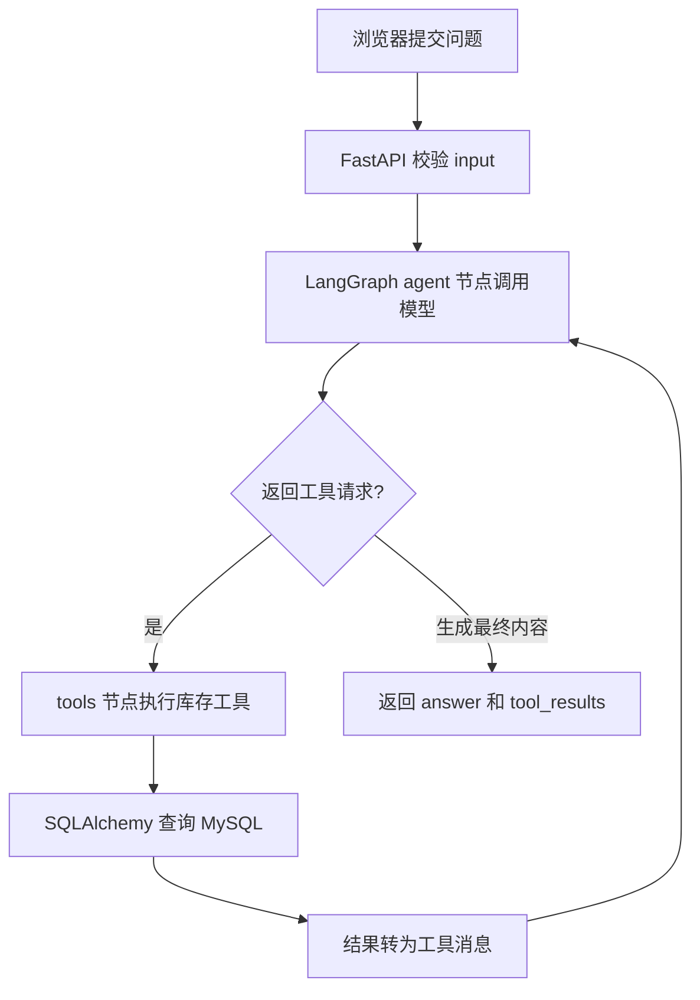
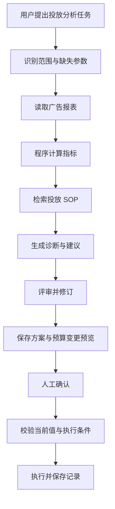

# 电商 Agent 双项目介绍与技术简历

更新日期：2026-11-05。

用途：项目立项说明、学习主线、求职作品集、简历项目经历和面试讲解。本文随代码与本人验收持续更新。

## 一、两个项目分别解决什么问题

| 项目 | 面向的人 | 解决的业务问题 | 交付结果 | 学习定位 |
|---|---|---|---|---|
| 运营提效助手 Agent | 店铺运营、运营主管 | 库存查数、异常汇总、查阅操作规范和整理日报需要反复切换页面 | 库存答复、异常清单、带依据的运营报告和待办 | 较轻项目，先跑通完整业务链 |
| 电商智能投放 Agent | 广告投手、投放主管 | 广告数据分散，指标口径容易混淆，优化建议与执行过程需要追踪 | 指标分析、诊断建议、预算变更预览及审批执行记录 | 深入项目，重点展示编排、恢复和工程能力 |

两个项目分别从独立目录搭建。共通原理集中学习，各自保留业务代码、演示和验收结果。

**当前定位为个人实战项目。** 运营助手已有本地运行证据；智能投放独立项目处于规划阶段。生产上线、个人职责、并发规模和业务收益按后续真实证据填写。

## 二、项目一：运营提效助手 Agent

### 2.1 项目介绍

面向电商运营的自然语言业务助手。运营人员输入商品编号和问题，系统判断需要使用的工具，由后端查询库存等业务数据，再交给模型组织答复。后续围绕这条链增加库存巡检、运营 SOP 检索、日报生成和任务记录。

当前例子：用户询问“查询 DEMO-EARBUDS-01 的可售库存和在途库存”，系统查询 MySQL 后返回可售 28、在途 120，并注明模拟数据来源。可售、预留、在途分别表达，查询结果带生成时间。

### 2.2 能给业务带来什么

- **减少查数步骤**：运营用一个问题获取商品库存信息，减少查找菜单、筛选和手工整理。
- **保留数据依据**：答复同时返回工具查询结果、数据来源和时间，便于核对数字。
- **集中整理异常**：后续将库存异常、处理规范和待办汇总到同一份报告，支持运营跟进。

以上属于产品价值目标。节省时间、使用率和准确率将在相同任务的人工操作与助手操作中实际测量。

### 2.3 当前实现范围

| 能力 | 截至更新日的状态 | 证据或边界 |
|---|---|---|
| 独立 Python 后端 | 已实现 | FastAPI 应用、分类目录、接口文档与健康检查 |
| 自有 MySQL 数据库 | 已实现 | Docker 本机实例、SQLAlchemy 查询、Alembic 迁移 |
| 模拟库存数据 | 已实现 | 独立 demo_inventory 表，参考真实库存字段，标记 synthetic_demo |
| 库存工具封装 | 已实现 | get_demo_inventory 接收 msku，使用参数绑定查询数据库 |
| 模型工具调用 | 已实现 | 模型返回工具名称和参数，后端执行查询并回传结果 |
| LangGraph 工具循环 | 已实现 | agent → tools → agent，工具调用上限与退出条件 |
| 请求和异常处理 | 已实现 | 输入校验、模型错误映射、整次请求超时与有效答复检查 |
| 公司测试登录与快照查询 | 已有独立验证 | 测试认证及测试快照接口单独保留；当前教学 Agent 使用模拟表 |
| 独立 Vue2 页面 | 待实现 | 已预留 frontend 目录；当前通过接口文档验证 |
| SOP、日报、定时巡检 | 待实现 | 后续按课程逐项交付 |
| 权限整合、审计、线上部署 | 后续阶段 | 按用户当前安排集中到上线环节学习与验收 |

代码实现、教师运行验证、本人独立掌握分别记录。本人需要能讲清调用链并完成独立修改，才能在面试中展开个人实现细节。

### 2.4 技术栈与职责

| 技术 | 在这个项目中负责什么 | 当前状态 |
|---|---|---|
| Python 3.11 | 编写接口、工具与 Agent 流程 | 已使用 |
| FastAPI / Pydantic | HTTP 接口、请求响应数据格式校验和文档 | 已使用 |
| LangChain 工具接口 | 工具描述、参数 Schema、模型绑定及工具消息 | 已使用 |
| LangGraph | 节点、消息状态、条件边和工具循环 | 已使用 |
| Qwen 模型服务 | 理解问题、生成工具请求、整理查询结果 | 已接通真实模型 API |
| SQLAlchemy / PyMySQL | 连接 MySQL、执行参数化查询、归还连接 | 已使用 |
| MySQL 8.4 | 保存自有业务快照与模拟库存 | 已使用 |
| Alembic | 记录并执行数据库结构变更 | 已使用 |
| Docker Compose | 启动本地 MySQL、保存持久化数据 | 已使用 |
| Vue2 | 独立业务页面、提问与结果展示 | 计划使用 |

模型通过兼容接口调用。langchain-openai 是当前模型连接适配包，实际供应商由本机配置决定，当前运行模型为 Qwen。

### 2.5 一次请求的完整调用关系



| 文件 | 职责 |
|---|---|
| app/main.py | 创建应用、注册路由和统一异常处理 |
| app/api/assistant.py | 接收问题、限制请求总耗时、调用图并返回结果 |
| app/schemas/assistant.py | 定义请求与响应格式 |
| app/core/model.py | 加载模型配置并创建模型客户端 |
| app/graphs/inventory_agent.py | 定义 agent/tools 节点、条件边、调用上限及结果组装 |
| app/tools/inventory.py | 实际执行库存查询 |
| app/db/session.py | 提供数据库引擎和连接池 |
| migrations/ | 记录数据库表结构版本 |

当前入口：`POST /api/v1/demo/assistant/chat`。

```json
{"input":"查询 DEMO-EARBUDS-01 的可售库存和在途库存"}
```

`bind_tools` 将工具名称、描述和参数格式交给模型；模型返回 `tool_calls`；后端的 ToolNode 执行对应 Python 工具；工具结果通过 ToolMessage 回到模型；模型生成用户可读的答复。

### 2.6 可以放进简历的当前版本

**项目名称：电商运营提效助手 Agent｜个人实战项目，持续开发中**

**技术栈：Python、FastAPI、LangGraph、LangChain、MySQL、SQLAlchemy、Alembic、Docker Compose。**

项目介绍：面向电商库存查询场景构建自然语言业务助手，实现用户提问、模型工具选择、数据库查询及结果解释的完整链路。

- 基于 FastAPI 和 Pydantic 构建结构化接口，按接口、图编排、工具、数据库和配置划分模块。
- 使用 LangGraph 实现模型与库存工具之间的循环调用，通过工具参数 Schema 和参数化 SQL 查询 MySQL，并返回数据来源及工具执行结果。
- 使用 SQLAlchemy 管理数据库访问、Alembic 管理表结构迁移，配置工具调用次数上限、请求超时和上游错误处理。
- 以真实库存字段设计模拟数据，完成真实模型 API 与本地 MySQL 的联调验证，持续扩展巡检和运营报告能力。

实际填写时，选择本人能够解释、修改和演示的条目。当前项目周期填写真实起止日期；线上用户数和收益字段待测量后补充。

### 2.7 面试开场讲法：约一分钟

> 我在做一个电商运营提效助手，先解决运营通过自然语言查询库存的问题。后端使用 Python 和 FastAPI，库存数据保存在 MySQL。模型根据问题生成库存工具的调用请求，后端执行 SQL 查询，再把结果交给模型生成回答。
>
> 我使用 LangGraph 管理模型与工具之间的循环，并设置工具调用次数上限和请求超时。接口会返回答复、数据来源和工具结果，便于核对数字。当前已完成本地真实模型和数据库联调，数据使用参考真实表结构构建的模拟库存。后续继续增加库存巡检、SOP 检索和运营日报。

### 2.8 必须能回答的追问

**问：模型怎样查询数据库？**

答：模型生成工具名称和参数，后端执行预先定义的工具函数。库存工具使用参数化 SQL 查询 MySQL，查询结果作为工具消息交回模型。

**问：为什么使用 LangGraph？**

答：库存问答包含模型选择工具、执行查询、读取结果和再次回答。LangGraph 用状态、节点和条件边明确表达这些步骤，方便控制循环、观察路径，并为后续恢复与审批扩展留出结构。

**问：怎样控制成本和失控循环？**

答：当前设置最多三次工具调用、模型单次超时和请求总超时。达到调用额度后使用已有结果整理答复；后续结合日志统计模型调用次数、Token 和耗时，再验证缓存及模型选型效果。

**问：如何保证数字可靠？**

答：库存数字取自工具查询结果，响应附带原始工具结果与来源标识。测试覆盖已知商品、未知商品及异常输入；后续通过评测检查答复与工具数字是否一致。模型事实准确性需要独立验证。

## 三、项目二：电商智能投放 Agent

### 3.1 项目介绍与当前状态

面向电商广告运营的投放诊断与建议执行助手。目标是把广告报表查询、指标计算、问题诊断、建议生成、人工审批和执行追踪连接为一条可审查的业务流程。

**当前独立工程仅建立目录，业务代码与部署待实施。** 之前课程练习已演示广告查询、ROAS 计算与工具循环，这些证据归属课程练习。独立投放项目将按功能重新搭建并保留自己的验收记录。

### 3.2 业务场景与价值

用户提出：“检查最近七天的广告活动，找出低于目标 ROAS 的活动，给出调整建议，预算变更提交主管确认。”

系统目标交付：

1. 查询指定日期的广告数据，核对币种、时区和归因窗口。
2. 用程序计算 ROAS、CTR、CPC，列出异常活动及依据。
3. 检索投放 SOP，形成建议与预算变更预览。
4. 保存审批结果，通过校验后执行允许的变更。
5. 记录执行前后值、工具结果和失败原因，支持查询与恢复。

业务价值目标包括减少报表整理时间、统一指标口径、提升建议可追溯性，以及降低重复执行和未经确认的预算变更风险。实际收益、转化提升和投放回报需通过后续数据验证。

### 3.3 计划技术栈

| 技术或能力 | 计划用途 | 状态 |
|---|---|---|
| Python / FastAPI / Pydantic | 业务接口、数据校验和任务入口 | 待独立项目实施 |
| LangChain / LangGraph | 工具封装、路由、分析子图和评审循环 | 待实施 |
| MySQL / SQLAlchemy / Alembic | 广告报表、任务、建议、审批和执行记录 | 待实施 |
| RAG / Embedding / 重排序 | 检索投放规则与 SOP，附带资料依据 | 待实施，存储方案随课程确定 |
| MCP / Skills | 统一工具接入、沉淀可复用投放流程 | 后续课程实施 |
| 图检查点与后台任务 | 长任务持久化、人工确认后恢复、批量巡检 | 待实施，具体组件按需求选择 |
| 独立 Web 前端 | 分析结果、变更预览、审批与任务历史 | 待实施，具体版本待建项确定 |
| Docker / 日志追踪 / CI/CD | 部署、故障定位、版本发布与回滚 | 后续部署阶段实施 |

### 3.4 目标调用流程



### 3.5 计划重点解决的技术问题

- **指标一致性**：ROAS=归因销售额÷花费；跨日数据先汇总金额再计算比率；零分母返回不可计算。ROAS 的解释同时考虑目标、毛利和其他成本。
- **建议质量**：事实引用报表，规则引用 SOP；缺失归因口径和预算边界时先补充信息。评审节点检查依据、矛盾和完整性。
- **受控执行**：变更绑定建议版本、审批结果与幂等键；执行前重新核对当前预算，保存执行记录。
- **任务可靠性**：外部请求超时、任务中断和重复触发分别处理；通过持久化状态、错误分类及恢复演练验证。

### 3.6 项目完成后的简历模板

> 使用时机：逐条完成实现、本人独立验收和演示后，将对应条目移入正式简历。当前可在作品集列为“在研项目”，说明目标与进展。

**项目名称：电商智能投放 Agent｜个人实战项目**

**技术栈：按最终实际使用的组件填写。**

项目介绍：面向电商广告运营构建投放分析助手，连接报表查询、指标计算、SOP 检索、诊断建议和审批执行流程。

- 基于 LangGraph 构建查询、指标计算、诊断与评审子图，支持按任务类型路由和有上限的修订循环。
- 封装广告报表及确定性指标计算工具，统一统计日期、币种与归因口径，为建议附加数据和规则依据。
- 设计建议、审批和执行记录，结合版本校验及幂等处理控制预算变更，支持人工确认与任务恢复。
- 构建业务评测集，记录工具选择准确率、任务完成率、耗时和 Token 成本，依据实测结果优化流程。

### 3.7 面试讲解的准备方向

| 追问 | 要准备的具体内容 |
|---|---|
| 为什么让代码计算 ROAS？ | 计算规则确定、结果可测试，模型负责解释与综合分析 |
| 两天 ROAS 应该怎么汇总？ | 两天归因销售额之和除以两天花费之和，并核对口径 |
| 为什么需要人工审批？ | 预算变更直接影响花费，审批将建议与实际执行连接起来 |
| 如何避免重复修改预算？ | 幂等键、执行记录、当前值和建议版本校验 |
| 任务执行到一半重启怎么办？ | 持久化任务状态和执行结果，恢复时核对已完成动作 |
| 如何证明优化有效？ | 固定评测集和业务口径，记录对照结果；收益归因单独验证 |

## 四、两个项目怎样形成求职竞争力

运营助手用于说明：我能够从自然语言问题打通 HTTP、模型、工具和数据库，并能解释每一步输入输出。

投放 Agent 用于说明：我能够在完整业务中处理指标口径、多步骤编排、知识检索、人工审批、重复执行和恢复问题。

前端工作经历用于说明已有的业务理解、交互实现和联调能力；两个项目补充 Python 后端、数据库与 Agent 工程证据。简历个人职责逐条对应本人实际工作与独立讲解能力。

## 五、后续要收集的简历证据

| 指标或材料 | 采集方式 | 当前状态 |
|---|---|---|
| 功能演示 | 固定问题、接口结果、页面和数据库记录对应展示 | 运营库存接口已有运行证据 |
| 正确率与任务完成率 | 固定案例集，记录预期、实际结果和失败类型 | 待建立正式评测集 |
| 响应耗时 | 多次请求记录中位数与 P95，并注明样本量及环境 | 当前仅有单次验证记录 |
| Token 与调用成本 | 记录模型用量、工具次数与当时单价 | 待统一统计 |
| 提效结果 | 相同任务对比人工与助手耗时，保留任务与样本量 | 待测量 |
| 部署与恢复 | 保存部署版本、健康检查、回滚及恢复演练结果 | 待实施 |

简历每个数字都附带测量条件；生产数据、模拟数据、课程练习和独立项目分别记录。下一步先完成运营助手库存问答的本人验收，再逐项补充可展示功能。
